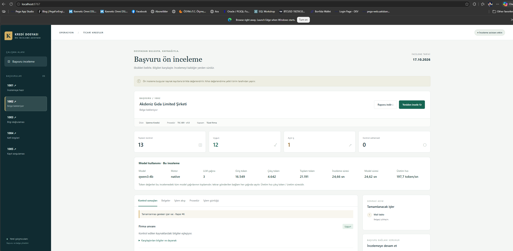
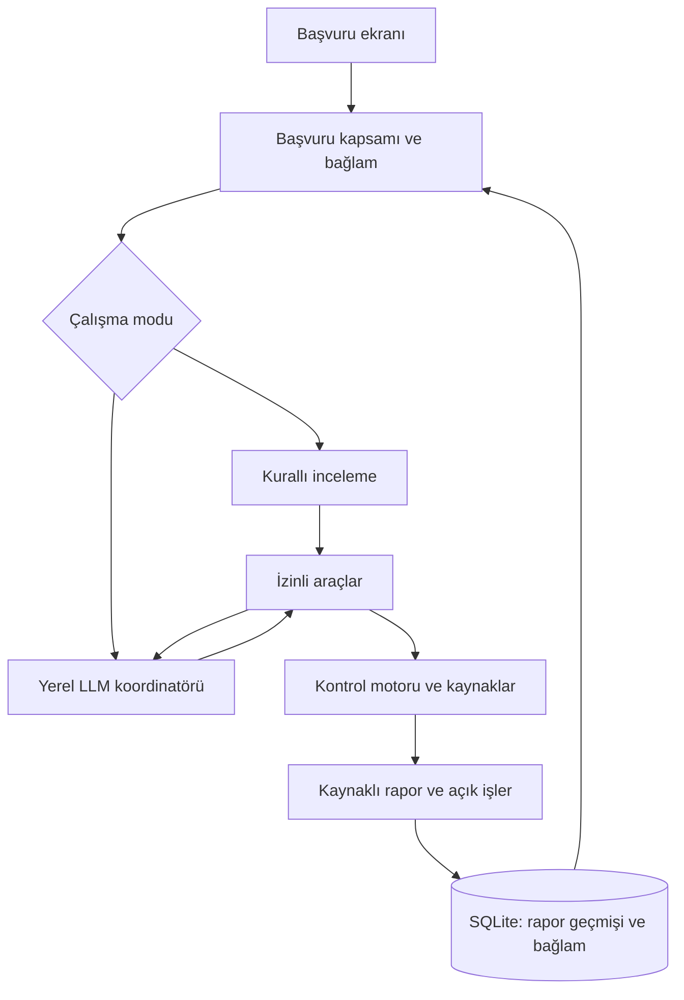

# Ticari Kredi Başvurusu Ön İnceleme Asistanı

Bu projeyi, ticari kredi dosyalarının uzman incelemesine hazırlanmasında farklı
kaynaklardan gelen bilgileri karşılaştırmak ve eksikleri takip etmek için geliştirdim.
Başvuru beyanını, müşteri kaydını ve belgeleri bir araya getiriyor; bulguları
kaynaklarıyla raporluyor, belge tamamlandığında incelemeyi sürdürüyorum.

**Python · Ollama / qwen3:4b · Araç çağrıları · SQLite · HTML/CSS/JavaScript**



## Çözdüğüm problem

Bir kredi dosyasında başvuru bilgileri, müşteri kaydı ve belgeler ayrı kaynaklarda
bulunabiliyor. Eksikleri bulmak, çelişkileri araştırmak ve yeni belge geldiğinde
kontrolleri tekrarlamak ek iş oluşturuyor. Bu akışı kaynaklı bir rapor ve
izlenebilir açık işler üzerinden yürütüyorum.

Uygulamadaki firmalar, kimlik/vergi numaraları ve ürün koşulları **kurgusal**.
Tek ürün ve tüzel firma başvurularını kapsayan eğitim projesi geliştirdim.
Gerçek banka servisine bağlanmıyor; kredi kararı, risk skoru veya limit üretmiyorum.

## Hızlı başlangıç

Python **3.11 veya üzeri** ve Git gerekiyor. Windows PowerShell'de:

```powershell
git clone https://github.com/o-kazancicok/ticari-kredi-on-inceleme.git
cd ticari-kredi-on-inceleme
.\setup.ps1
.\start.ps1 -Mode demo -Port 8767
```

Uygulama **http://localhost:8767** adresinde açılır. Ctrl+C ile durduruyorum.
Kurulum `.venv` oluşturur, kilitli bağımlılıkları kurar ve `.env` dosyasını
`.env.example` şablonundan hazırlar. Mevcut ayarları ve kayıtları korur.

### Yerel LLM ile çalıştırma

Temel kurulumdan sonra:

```powershell
.\setup-ollama.ps1
.\start.ps1 -Mode agent -Port 8767
```

Ollama kurulum betiği resmî Windows paketini SHA256 kontrolüyle indirir ve
**qwen3:4b** modelini hazırlar. İlk kurulum internet ve model için yeterli disk/bellek
gerektirir. Normal başlatmada model yeniden indirilmez. Agent isteklerini yerel
Ollama servisine gönderiyorum; haricî LLM API anahtarı kullanmıyorum.
Model hatasında sessizce kurallı moda geçmiyorum.

Mac/Linux'ta kurallı akış:

```bash
python3 -m venv .venv
.venv/bin/python -m pip install -r requirements-lock.txt
.venv/bin/python app.py --mode demo --port 8767
```

[Ayarlar ve manuel kurulum](docs/ORTAM_VE_GITHUB.md) · [Ollama ayrıntıları](docs/OLLAMA.md)

## Kullanım ve senaryolar

| Başvuru | Senaryo | Başlangıç sonucu |
|---|---|---|
| 1001 | Eksiksiz dosya | 13 kontrol uygun |
| 1002 | Eksik mali tablo | 12 uygun, 1 eksik belge |
| 1003 | Başvuru ve müşteri unvanı farklı | 12 uygun, 1 doğrulama gerekli |
| 1004 | Kefil kimlik alanı eksik | 12 uygun, 1 eksik bilgi |
| 1005 | Müşteri servisine erişilemiyor | 6 uygun, 6 kontrol edilemedi |

1. **1002** başvurusunda incelemeyi başlatıyorum.
2. **Belgeler → Mali tabloyu ekle** ile eksik belgeyi tamamlıyorum.
3. **Yeniden incele** ile açık işin kapandığını ve önceki rapora göre değişimi görüyorum.
4. **1003** ile unvan uyuşmazlığını, **1005** ile servis hatasını inceliyorum.

1003'te başvuru ve müşteri kaydı farklı olduğu için yalnızca belge yüklemek
uyuşmazlığı çözmüyor. Uygulama bir kaynağı kendiliğinden doğru kabul etmiyor.
Tekrarlanabilir sonuçlar için inceleme tarihini **17 Ekim 2026** olarak sabitledim.

Belge yükleme, belge silme, kaynak/dayanak görüntüleme, raporu Markdown olarak
indirme ve önceki raporla karşılaştırma destekleniyor. Sohbette “Eksikleri göster”,
“Tekrar incele” ve “Belge tarihi kuralı nedir?” komutlarını kullanıyorum.

## Agentic mimari

Sabit iş kurallarını kodla, araç seçimini yerel modelle ele aldım. Native agent,
Ollama'nın araç çağrılarını çalıştırır, sonuçları modele geri verir ve bütün
kontroller tamamlanana kadar en fazla 16 tur devam eder. Nihai bulguları kontrol
motoru üretir; modelin serbest metnini rapor sonucu olarak kullanmıyorum.



Başvuru, müşteri, belge ve prosedür sorgulama; kimlik, faaliyet, iletişim, kefil ve
belge kontrolü; belge okuma ve prosedür arama araçlarını kullanıyorum. Araçları
seçili başvuruyla sınırlandırdım. SQLite'ta rapor sürümlerini, belge olaylarını
ve sohbetin başvuru bağlamını saklıyorum.

Kurallı mod, LLM kullanmadan aynı kontrolleri sabit sırayla çalıştırır.
Prosedür araması anahtar kelime tabanlıdır; anlamsal RAG kullanmıyorum.
LangGraph ve FastMCP adaptörleri isteğe bağlıdır; doğrulanmış ana akış **native** motordur.

## Belgeler, model kullanımı ve günlükler

- **Belge alımı:** UTF-8 TXT veya metin içeren PDF; en fazla 2 MB / 10 sayfa.
  Alanları etiketli metinden çıkarıyorum. Örnekler [examples/](examples/) klasöründe.
- **Belge silme:** Seçili belge onayla kaldırılır. Eski raporlar korunur; belge kümesi
  değiştiğinde yeniden inceleme uyarısı gösterilir. Aynı türün kalan son belgesi kullanılır.
- **Model kullanımı:** Model adı, motor, çağrı sayısı, giriş/çıkış/toplam token,
  inceleme/model süresi ve üretim hızı raporla saklanır. Token toplamına her turda
  yeniden gönderilen bağlam da dahildir. Ölçüm yoksa tahmin gösterilmez.
- **İşlem günlüğü:** Kritik işlemlerin öncesi, sonucu, takip kimliği ve süresi
  terminalde ve arayüzde görünür. En fazla 2.000 kayıt bellekte tutulur; uygulama
  süreci kapandığında silinir. Belge, sohbet ve model içerikleri loglanmaz.

TXT alan biçimi:

```text
Unvan: Güney Tarım Limited Şirketi
Vergi Numarası: 0000000001
Hukuki Şekil: LIMITED
Kuruluş Tarihi: 2020-06-15
Faaliyet Konusu: Sebze ve meyve toptan ticareti
NACE: 463101
```

## Doğrulama

**29 Ekim 2026:** 41 otomatik test ve 22 HTTP kontrolü geçti. Beş kurgusal
senaryoyu, belge ekleme/silme, yeniden inceleme, kaynak kapsamı, hata yönetimi ve
geçici günlükleri test ettim. Native agent akışını gerçek **qwen3:4b** modeliyle
beş başvuruda, belge tamamlama sonrasında ve web API üzerinden doğruladım.

```powershell
.venv\Scripts\python.exe -m unittest discover -s tests -v
.venv\Scripts\python.exe evaluate.py
.venv\Scripts\python.exe scripts/verify_http.py
.venv\Scripts\python.exe scripts/verify_agent.py
```

HTTP kontrolleri Node.js **22+**, gerçek model testi hazır bir yerel Ollama servisi
gerektirir. Testlerde geçici veri kümeleri kullanıyorum.
[Doğrulama sonuçları ve ölçüm kapsamı](docs/DOGRULAMA.md).

## Ekran görüntüleri ve belgeler

[Yedi ekran görüntüsünün tamamı](docs/ekran-goruntuleri/README.md): ana ekran,
eksik belge, belge sonrası inceleme, unvan uyuşmazlığı, model ölçümleri,
servis hatası ve terminal logları.

- [Kullanım ve sunum akışı](docs/DEMO_SENARYOSU.md)
- [Kurulum ve ortam ayarları](docs/ORTAM_VE_GITHUB.md)
- [Yerel model](docs/OLLAMA.md)
- [İşlem günlüğü](docs/ISLEM_GUNLUGU.md)
- [Örnek rapor](docs/ORNEK_RAPOR.md)
- [Projenin iş değeri](docs/BANKAYA_KATKI.md)
- [Bootcamp kapsamıyla eşleştirme](docs/PROJE_UYGUNLUGU.md)

## Kapsam sınırları

OCR, serbest biçimli belge yorumlama, finansal yeterlilik analizi, gerçek banka
API bağlantısı ve resmî kimlik doğrulaması kapsamda değil. Sohbet komutlarını
kurallı yönlendiriyorum; genel amaçlı serbest sohbet sunmuyorum.

Uygulama yerel bilgisayarda çalışır. Kullanıcı girişi, rol bazlı yetki ve kurumsal
veri saklama altyapısı bulunmadığından gerçek müşteri verisiyle üretim kullanımı
amaçlamıyorum. Test sonuçları küçük bir kurgusal veri kümesine ait;
gerçek bankada başarı oranı veya zaman tasarrufu iddiası taşımıyor.

`.env`, model dosyaları, yerel veritabanları, günlükler ve IDE ayarları Git dışında.
Paylaşılan ayar şablonu `.env.example` kurallı modla başlar.

## Yararlandığım kaynaklar

- [Ders örnekleri](https://github.com/turkiyeyapayzekaakademisi/ai-agents)
- [Ollama araç çağrıları](https://docs.ollama.com/capabilities/tool-calling)
- [Ollama token ve süre sayaçları](https://docs.ollama.com/api/chat)
- [LangGraph](https://docs.langchain.com/oss/python/langgraph/quickstart)
- [FastMCP](https://gofastmcp.com/servers/tools)
