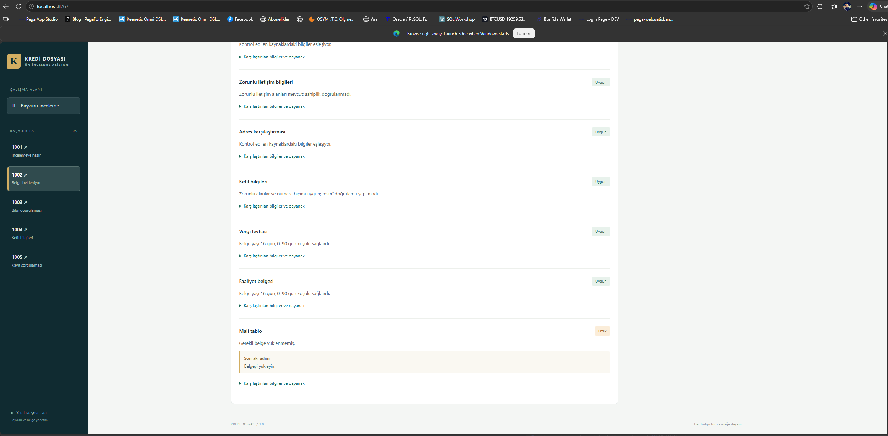
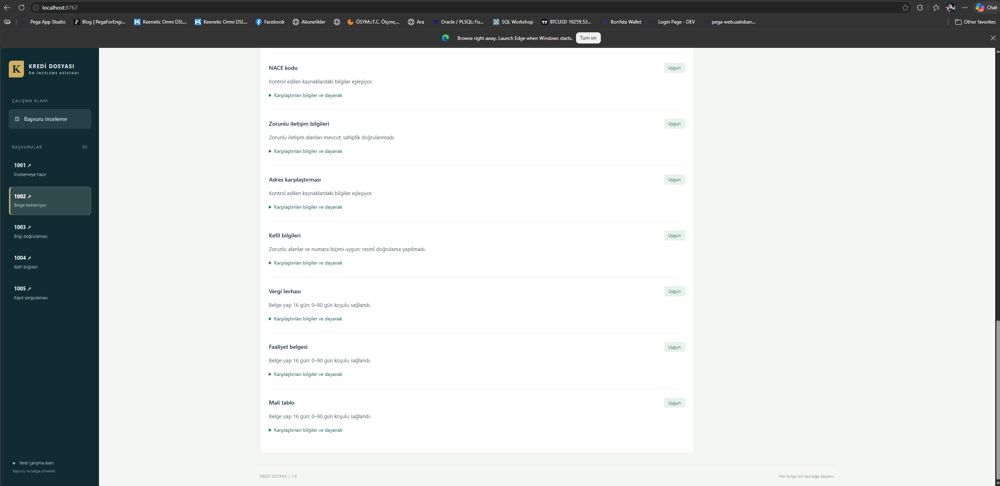
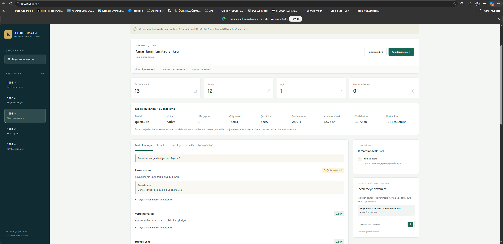
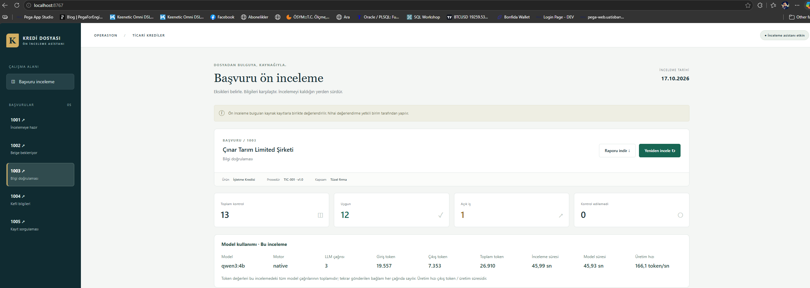
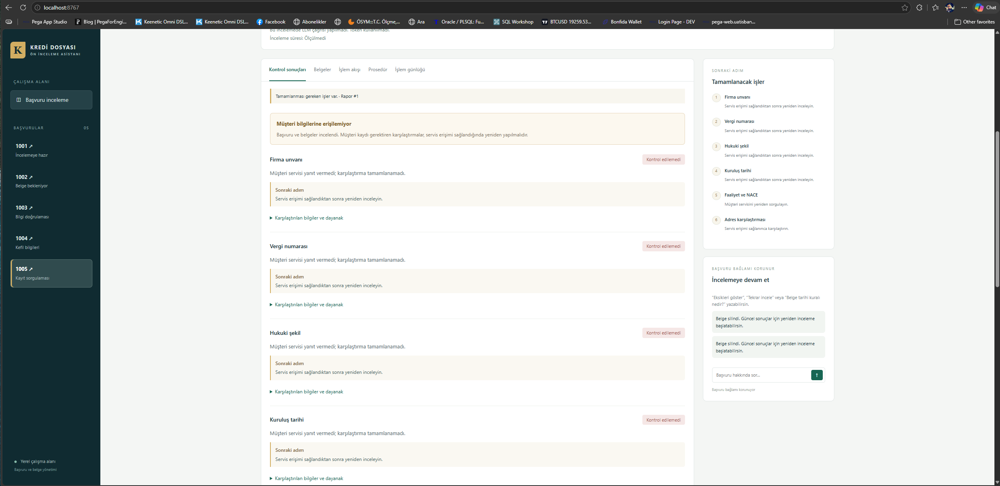
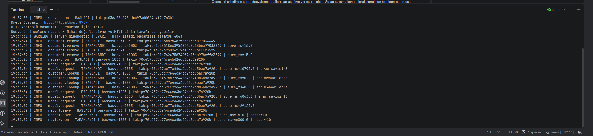

# Çalışan uygulamanın ekran görüntüleri

Kurgusal başvurularla çalıştırdığım uygulamanın ekran görüntülerini burada topladım.
Model ölçümleri ilgili incelemeye ait; servis hatası görseli kurallı inceleme sonucunu gösteriyor.

## Ana ekran

Başvuru özeti, kontrol sayıları ve model kullanımı.

## Eksik belge

1002 başvurusunda eksik mali tablo bulgusu.

## Belge sonrası inceleme

Mali tablo eklendikten sonra ilgili kontrolün uygun duruma gelmesi.

## Unvan uyuşmazlığı

1003 başvurusunda doğrulama gerektiren unvan farkı.

## Yerel model ölçümleri

qwen3:4b model adı, çağrı sayısı, token ve süre ölçümleri.

## Servis hatası

1005 başvurusunda tamamlanamayan müşteri kaydı kontrolleri.

## Terminal logları

Belge silme, inceleme, model çağrısı ve rapor kaydının başlangıç/sonuç logları.

